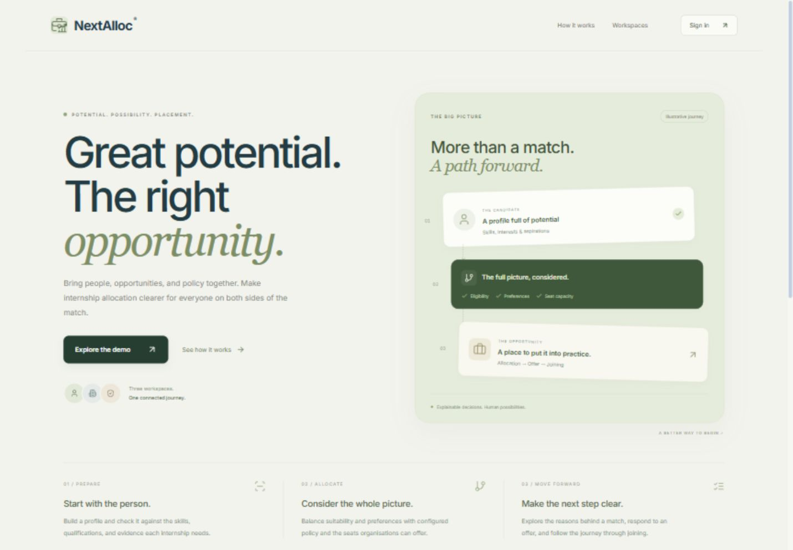
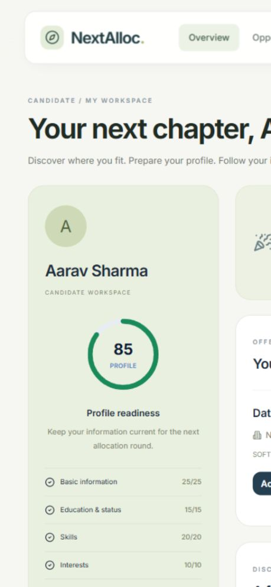
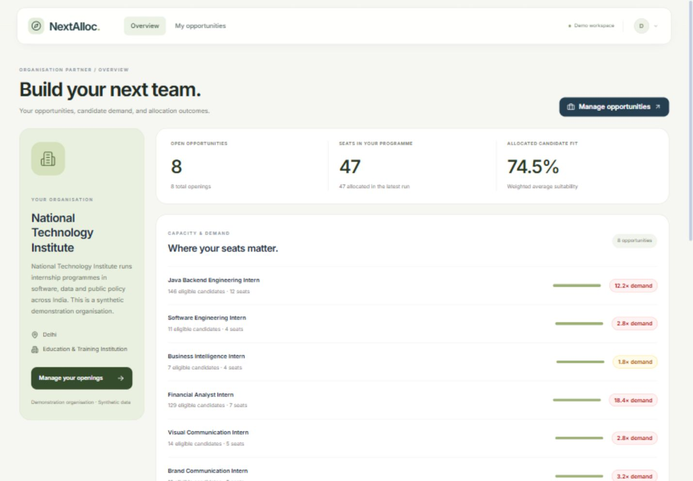

# Internship Allocator AI

A repository for internship allocation experiments and the current NextAlloc demonstration. The latest interface covers administrators, organisation partners, and candidates.

## Choose an application

| Application | Location | Stack | Purpose |
| --- | --- | --- | --- |
| **NextAlloc demonstration** | [nextalloc/](nextalloc/README.md) | React 18 + Vite, Spring Boot / Java 17, FastAPI / Python, OR-Tools CP-SAT | Current three-role product demo with profile, eligibility, allocation, offers, and organisation workflows |
| AllocateAI prototype | Repository root | Next.js, FastAPI, OR-Tools, SQLite | Original operator-driven allocation workbench with explicit eligible matches and group minimums |

These applications remain separate. The NextAlloc redesign does not migrate its frontend to Next.js. The original Next.js app and its history are preserved.

## Latest UI update

- Shared floating navigation with grouped administrator menus, contextual route descriptions, account controls, and mobile navigation.
- Product landing hero with an illustrated profile-to-placement journey, working demo/sign-in links, and a three-step explanation before role selection.
- Administrator allocation overview with policy controls.
- Organisation dashboard with capacity, candidate demand and allocation impact, plus searchable opening cards and opportunity/offer controls.
- Candidate dashboard with readiness, allocation, offers and recommendations; discovery filter rail; fit studio; profile section shortcuts and labelled form fields.
- A compact SVG logo and favicon adapted from the supplied NextAlloc briefcase-and-growth artwork, in sage and forest green to match the interface. The original wordmark is included in the frontend's public assets.

### Product landing page

### Candidate workspace

### Organisation partner workspace

Screenshots show synthetic demonstration records. Results depend on the current seed data and allocation runs.

## Start the current demo

See [NextAlloc setup and demo credentials](nextalloc/README.md) for the full steps. Install Node.js 22, Python 3.11, Java 17 and Maven 3.9 or later, then build the frontend, start the FastAPI AI service on port 8000, and start Spring Boot on port 8080.

Open **[http://localhost:8080/login](http://localhost:8080/login)** and choose Administrator, Organisation Partner, or Candidate. Default H2 storage is in memory; restarting the backend resets demo records, rounds and offers.

To run the original Next.js prototype, follow [the preserved AllocateAI guide](docs/ALLOCATEAI_PROTOTYPE.md).

## How allocation works

In NextAlloc, the backend evaluates eligibility and suitability using candidate profiles, opportunity requirements and configured policy. The Python service exposes deterministic skill intelligence and CP-SAT optimization. The backend persists the run and exposes explanations and offer workflows through role-restricted APIs. Recommendations describe individual fit; they are not final allocation decisions.

The original AllocateAI prototype instead accepts pre-screened candidate-opportunity edges and integer scores, then maximizes placement count followed by suitability, subject to capacities and configured minimum group counts.

The router/worker-swarm/blackboard/critic architecture discussed in the research plan is an intended research direction. The current interface and deterministic demo do not establish a fully implemented LLM agent swarm, formal concurrency proof, patentability, or benchmark superiority.

## Verification and delivery status

For this UI release on **12 November 2026**:

- Frontend type checking passed.
- All **9 frontend contract tests** passed.
- Production frontend build passed and was copied to the served static directory.
- Browser checks covered role sign-in, partner search and editor fields, offer listing, candidate discovery/details, fit selection, profile navigation and responsive layouts.
- Local website and AI service health checks returned HTTP 200 after restart.

The backend/AI test suites and Docker deployment were not rerun for this UI release. This is a demonstration release, with synthetic accounts and a default signing secret. Client deployment still requires persistent storage and backups, private secrets and account provisioning, monitoring, dependency/security review, load testing and full accessibility/security acceptance.

The [earlier implementation/comparison report](docs/STATUS_AND_COMPARISON.md) describes the original AllocateAI prototype, before this NextAlloc snapshot was added. Read it in that scope.

## Source and attribution

The `nextalloc/` application is based on [PrShivashish/NextAlloc](https://github.com/PrShivashish/NextAlloc), snapshot commit `ea2b498cb5e55602466c7cefbd2ee6dbe74d9d59`, with local UI changes. Its [MIT license](nextalloc/app/LICENSE), copyright notice and [third-party notices](nextalloc/app/THIRD_PARTY_NOTICES.md) are retained. See [source details](nextalloc/SOURCE.md). The teammate's allocation backend and existing workflows are credited to that source; the redesign does not claim to originate them.

Runtime databases, uploads, tokens, local toolchains, installed dependencies and logs are excluded from version control.
